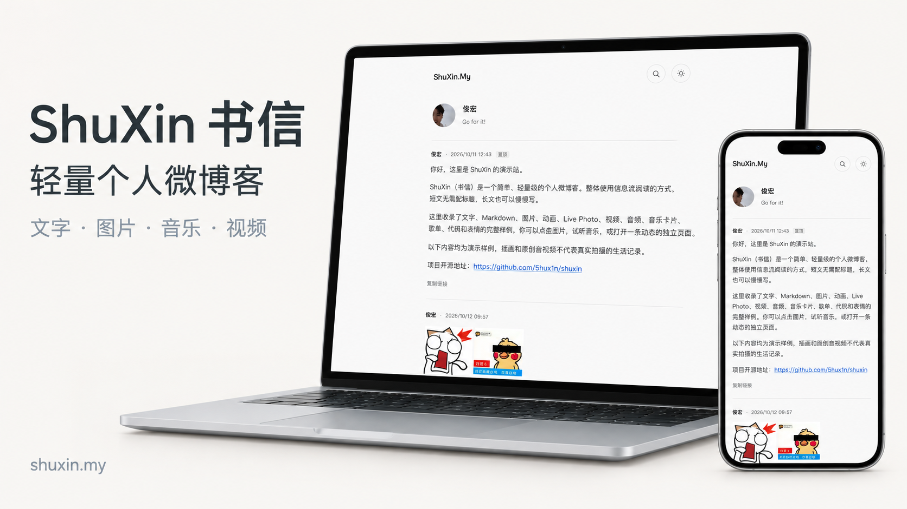

# ShuXin · 书信

轻量、可自托管的个人微博客。站长发布，访客阅读；从一句话、一张图到一篇长文，都留在同一条单列信息流里。

[在线演示](https://shuxin.my/) · [下载 1.0.0](https://github.com/5hux1n/shuxin/releases/tag/v1.0.0) · [部署文档](docs/DEPLOYMENT.md) · [让 AI 帮你部署](AI_DEPLOYMENT.md)



宣传图基于演示站制作，设备画面为 AI 合成效果图。查看单独的[手机端](docs/images/promo-mobile.png)和[电脑端](docs/images/promo-desktop.png)展示。

## 主要功能

- **连续阅读**：单列时间线、置顶、加载更多、长文展开、独立链接、搜索与回到顶部。
- **自由记录**：无需标题，支持 Markdown、代码高亮、图片、GIF、Live Photo、音视频、音乐卡片、歌单和文件下载卡片。
- **轻量管理**：发布、编辑、删除、草稿与文件库；后台标签直接切换，适配手机和电脑。
- **个人外观**：头像、昵称、简介、头像跳转链接、图片与文字 Logo、日夜模式、背景图及不透明度。
- **内容权限**：公开、不列出、私密三种可见性；草稿与私密内容的媒体按权限访问。
- **自己掌握数据**：SQLite、内容与媒体备份；支持 Node、Docker、Cloudflare Workers 和可选对象存储。

这是单站长系统，不提供公开注册、多用户社交、RSS 或旧 Pigeon 数据迁移。音乐播放受平台公开音源和浏览器能力限制。

## 部署后是什么样？

部署得到与此版本一致的界面和功能，以及一个空站。首次访问 `/admin/setup` 创建自己的站长账号，再进入后台设置头像、Logo、背景并发布内容。

演示站的账号、密码、头像、动态、上传文件和外观配置不会复制到新站。背景图片可自行配置；默认使用简洁的浅色底色。

`1.0.0` 为当前产品的初始发布，默认分支 `main` 与发布标签同步。获取固定版本请使用下方指定标签的命令，或下载对应 Release。

## 快速部署

### Cloudflare Workers

[](https://deploy.workers.cloudflare.com/?url=https://github.com/5hux1n/shuxin/tree/v1.0.0)

部署到自己的 Cloudflare 账号，配置 `SITE_URL` 为最终访问地址，`SESSION_SECRET` 为至少 32 字符的随机会话密钥。部署后访问 `/admin/setup` 创建站长。

默认使用单个 SQLite Durable Object 保存站点数据，无需额外配置 D1 或 R2。完整步骤见 [Cloudflare 部署](docs/CLOUDFLARE.md)。

### 宝塔 / Node 服务器

从 [1.0.0 Release](https://github.com/5hux1n/shuxin/releases/tag/v1.0.0) 下载 **`ShuXin_1.0.0_server.zip`**，解压后在 Node.js 24 环境执行：

```sh
npm ci --omit=dev --no-audit --no-fund
node scripts/setup-server.mjs https://你的域名
npm start
```

再设置 HTTPS 反向代理到 `127.0.0.1:4321`。运行包已构建，不需要在服务器构建前端，也不包含站点数据。宝塔的项目与目录权限设置见 [宝塔安装](docs/BAOTA.md)。

### 本地开发 / 源码部署

需要 Node.js 22.12+，建议 Node.js 24。

```sh
git clone --branch v1.0.0 --depth 1 https://github.com/5hux1n/shuxin.git
cd shuxin
npm ci
cp .env.example .env
openssl rand -hex 32
```

把生成的随机值填入 `.env` 的 `SESSION_SECRET`，然后启动：

```sh
npm run dev
```

访问 `http://localhost:4321/`，首次创建站长使用 `/admin/setup`。源码正式运行执行 `npm run build` 和 `npm start`；Docker 部署见 [安装与部署](docs/DEPLOYMENT.md)。

> [!IMPORTANT]
> 升级前先备份。Node 保留 `.env` 和整个 `data/`；Workers 保留站点 Durable Object 与绑定；第三方存储桶需单独备份。

## 文档

| 你想做什么 | 文档 |
| --- | --- |
| 部署或升级站点 | [Node / Docker](docs/DEPLOYMENT.md) · [Cloudflare](docs/CLOUDFLARE.md) · [宝塔](docs/BAOTA.md) |
| 让 AI 实际完成部署 | [AI 部署指南](AI_DEPLOYMENT.md) |
| 配置背景和存储 | [背景](docs/BACKGROUND.md) · [对象存储](docs/OBJECT_STORAGE.md) |
| 使用文件库、音乐和表情 | [文件管理](docs/FILE_LIBRARY.md) · [功能与限制](docs/FEATURES.md) · [表情来源](docs/EMOJI_SOURCES.md) |
| 备份和恢复数据 | [备份恢复](docs/BACKUP.md) |
| 了解权限与第三方授权 | [安全设计](docs/SECURITY.md) · [第三方说明](docs/THIRD_PARTY.md) |

技术栈：Astro、TypeScript、Drizzle ORM 与 SQLite。页面与 API 在 `src/pages/`，业务在 `src/lib/`，界面组件、样式与交互在 `src/components/`、`src/styles/`、`src/scripts/`。

理念参考 [Pigeon](https://github.com/kasuganosoras/Pigeon)，新实现独立开发。源码采用 [MIT](LICENSE) 许可；第三方字体、图标和表情按各自许可使用。
